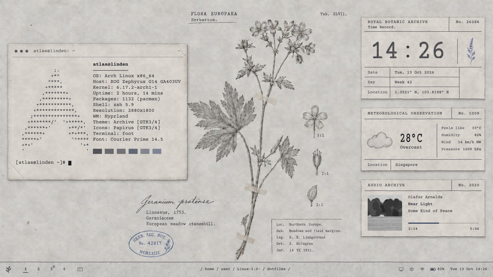
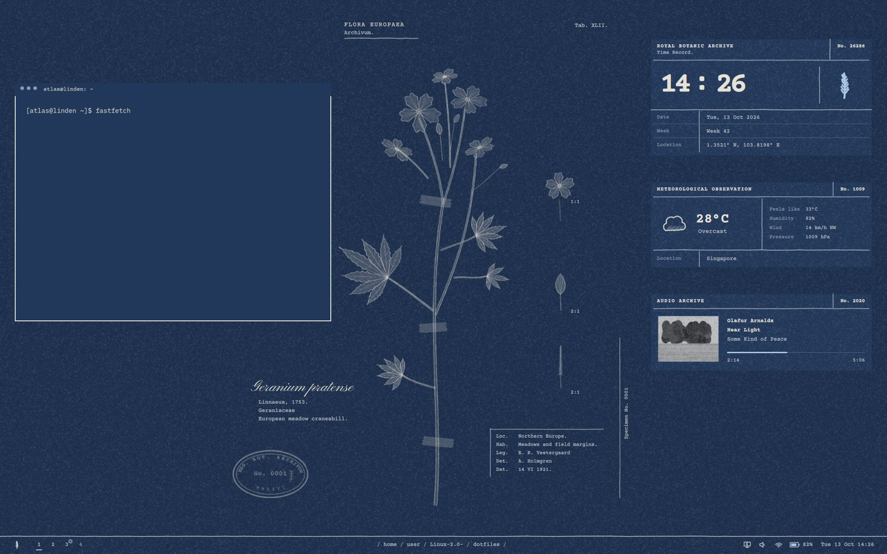

# Archive desktop: the install guide

From a fresh Arch Linux install on the ASUS ROG Zephyrus G14 (2024) to the
botanical-archive desktop in the reference mockup. Follow the phases in order.
Each phase ends with a check, so you know it worked before moving on.

You start with:

- Arch Linux installed next to Windows, booting through GRUB.
- A user account with `sudo`, and working internet (`ping archlinux.org`).
- Whatever G14 tweaks you already made. Phase 1 lists what this setup expects,
  so you can tick off what you have.

Total time: about an hour, most of it waiting for downloads.

> **In a hurry?** If Arch and Hyprland already run, `~/archive/setup.sh` does
> Phases 2 to 7 in one go (packages, linking, G14 GPU names, the plugin, the
> login screen). Clone the repository to `~/archive` first (Phase 2), run it,
> then reboot and continue at Phase 8.

> **What you get.** Hyprland 0.55+ (Lua config) handles windows: paper cards
> with torn edges and short soft shadows, darker-edged when focused, with
> typed title bars. Quickshell 0.3+ draws everything else: the plate wallpaper,
> the record cards, the footer bar, the launcher, calendar, quick settings, power
> menu, notifications, volume reading and lock screen. Day is grey paper and
> graphite. Night is cyanotype blue, and the switch happens at sunrise and sunset.



---

## Phase 0: Before you start

Run these in a terminal (TTY is fine):

```sh
# 1. fully up to date
sudo pacman -Syu

# 2. the multilib repo is needed for lib32-nvidia-utils (Steam, Wine, 32-bit GL)
grep -n '^\[multilib\]' /etc/pacman.conf || echo "multilib is OFF"
```

If multilib is off, open `/etc/pacman.conf` with `sudo nano /etc/pacman.conf`,
uncomment the two lines `[multilib]` and `Include = /etc/pacman.d/mirrorlist`,
then run `sudo pacman -Syu` again.

```sh
# 3. NetworkManager will own the network from now on
sudo pacman -S --needed networkmanager git
sudo systemctl enable --now NetworkManager
```

If you set up the network another way during the install (for example
`iwd` or `systemd-networkd`), disable that so the two don't fight:
`sudo systemctl disable --now iwd systemd-networkd`. Reconnect to Wi-Fi with
`nmtui`.

**Dual boot clock.** Windows keeps the hardware clock in local time and
Linux keeps it in UTC, so the clock is wrong after every switch. The cleanest
fix is to make Windows use UTC. In an admin PowerShell in Windows, run:
`reg add "HKLM\System\CurrentControlSet\Control\TimeZoneInformation" /v RealTimeIsUniversal /t REG_DWORD /d 1 /f`
Also turn off Windows *Fast startup* (Control Panel → Power Options), or
Windows keeps its disks locked and the Wi-Fi card half asleep.

**Check:** `pacman -Q git networkmanager` lists both, and `ping -c1 archlinux.org` works.

---

## Phase 1: Zephyrus G14 essentials

Read [docs/zephyrus-g14.md](docs/zephyrus-g14.md) and do the steps you don't
already have. The desktop expects:

| Needed for | What |
| --- | --- |
| Fan and power profiles, the fan key, the Instruments card | `asusctl`, `power-profiles-daemon` |
| GPU modes, rendering on the AMD iGPU | `supergfxctl`, NVIDIA driver (`nvidia-open-dkms`) |
| The ROG key | `rog-control-center` |
| Stable GPU names for Hyprland | the udev rule from Phase 4 |

**Check:** `asusctl --version`, `supergfxctl -g` (prints `Hybrid`) and
`powerprofilesctl get` all answer.

---

## Phase 2: Get this repository

Keep it somewhere permanent. The installer *links* your config to this folder,
so `git pull` here updates your desktop later.

```sh
git clone https://github.com/midnightrainveil-sketch/Linux-2.0-.git ~/archive
cd ~/archive
git checkout claude/hyprland-ui-setup-l5njnw   # until it is merged into main
```

**Check:** `ls ~/archive` shows `install.sh`, `GUIDE.md`, `dotfiles/`.

---

## Phase 3: Install the packages

```sh
cd ~/archive
./install.sh --packages
```

This installs everything in [packages/pacman.txt](packages/pacman.txt):
Hyprland and its portal, hypridle, the polkit agent, Quickshell with the Qt
modules it needs (`qt6-5compat`, `qt6-svg`), foot, zsh, fastfetch, PipeWire,
NetworkManager tools, BlueZ, brightnessctl, grim and slurp, the IBM Plex fonts,
adw-gtk3, Papirus icons, qt6ct, the greeter, and Firefox and Nautilus. Swap the
last two for your own apps if you like.

Everything comes from the official repos, so you need no AUR helper.
Courier Prime and Pinyon Script (both SIL Open Font License) ship inside this
repo.

If pacman asks which provider to use (for example for `jack`), the default is
fine.

**Check:** `Hyprland --version` reports **0.55 or newer** and
`qs --version` reports **0.3 or newer**. Older versions won't read this config,
which uses Hyprland's Lua format and Quickshell's networking API.

---

## Phase 4: Give the GPUs stable names (G14)

Hyprland should render on the AMD iGPU and keep the NVIDIA dGPU only for what
needs it. That saves battery, keeps the laptop cool, and avoids NVIDIA Wayland
quirks. The `/dev/dri/cardN` numbers can change between boots, so a udev rule
gives the GPUs fixed names:

```sh
./install.sh --g14
```

This writes `/etc/udev/rules.d/90-archive-gpu-names.rules`. Hyprland reads
these names in `~/.config/hypr/archive/machine.lua`.

**Check:** `ls -l /dev/dri/amd-igpu /dev/dri/nvidia-dgpu` shows two symlinks
(reboot once if they're not there yet).

---

## Phase 5: Link the configuration

```sh
./install.sh
```

This step:

- symlinks everything in `dotfiles/` into your home folder. Any file it
  replaces is moved to `~/.archive-backup/<date>/` first.
- refreshes the font cache.
- sets the day or night mode by the clock and themes GTK, Qt and foot to match.
- enables `archive-mode.timer`, which checks for sunrise and sunset every 5 minutes.
- enables Bluetooth and power-profiles-daemon.
- makes zsh your login shell.

It's safe to run again at any time.

**Check:** `ls -l ~/.config/hypr/hyprland.lua` points into `~/archive/dotfiles`,
and `archive-mode status` prints `day` or `night`.

---

## Phase 6: Choose how Hyprland starts

**Option A, typed login screen (recommended).** greetd with tuigreet shows a
plain typed prompt on boot and starts Hyprland:

```sh
./install.sh --greeter
```

If another display manager is enabled, disable it first, for example
`sudo systemctl disable sddm`.

**Option B, from the TTY.** Log in on tty1 and type `start-hyprland`.

Since 0.53, Hyprland starts with `start-hyprland`, not `Hyprland`.

Now reboot: `sudo reboot`. At the GRUB menu, pick Arch.

---

## Phase 7: First login

After logging in you should see, within two seconds:

1. The grey paper sheet with the pencil *Geranium pratense* plate in the centre.
2. The three record cards on the right: Time Record, Meteorological
   Observation and Audio Archive.
3. The footer bar: the sprig, workspaces `1 2 3 4`, `/ home / you /`, status
   marks and the date.
4. A terminal card on the left showing fastfetch (the "desk terminal").

The windows don't have their typed title bars yet. Build them once, from a
terminal inside Hyprland (`Super + Return`):

```sh
cd ~/archive
./install.sh --plugins
```

This builds **archivebars**, which is hyprbars plus what the reference
windows need and Hyprland lacks: the ruled line under the bar, the "–" on its
right, and the **torn paper edge** around every window. It fetches the
hyprbars source that matches your Hyprland, patches it and compiles it, which
takes a minute. After a Hyprland update, or a `git pull` that changes the
plugin, it rebuilds itself at the next login (`archive-bars ensure`). If a
build ever fails, the installer falls back to stock hyprbars: the same bar,
without the rule and the dash, and windows get a plain straight rim.

How the edge works: each window sits on a paper card 6 px larger than
itself. Under the window the plugin draws the card: a torn outline lit from
the top left (palest along the top, darkest along the bottom and right),
chips bitten out of the edge with pale torn fibres, worn corners, and a soft
shadow falling down and to the right. Over the window's padding it adds the
aged edge (a blotchy darkening that fades inward), small tears, short
wrinkles and, on some corners, a soft crease. All of it is built from short
tiles drawn once and repeated along each side, so any window size works and
resizing costs nothing. Each window gets its own pattern. The terminal's
background is the same paper, so the window's straight edge disappears into
the card.

**Check:** new windows have a 46 px paper title bar: three dark ink dots, the
title, a "–" at the far right and a thin ruled line underneath. The window's
outline is torn paper, not a straight line, and a short soft shadow falls
below it. Terminals and the system's tools are grained like paper; browsers,
players and other apps keep their true colours. The "░" left of the "–"
shows a window's grain (dark: on, faded: off) and a click flips it, as does
`Super + Shift + G`. `archive-bars status` shows what the plugin was built
for.

### Make it say *atlas@linden* (optional)

The mockup's host is `linden`. To match it:

```sh
sudo hostnamectl set-hostname linden
```

The bar, title bars and prompt all take the name from your user and host.

---

## Phase 8: Tell the archive where you are

Edit `~/.config/archive/settings.json` (it's tracked in your clone). The shell
picks up changes as soon as you save.

```json
"location": { "name": "Singapore", "country": "Singapore", "latitude": 1.3521, "longitude": 103.8198 },
"dayStart": "07:00",
"nightStart": "19:10"
```

The weather comes from Open-Meteo, which needs no account or API key. All the
other settings are listed in [docs/customise.md](docs/customise.md).

**Check:** the Meteorological card shows a temperature, and its catalogue
number is the current air pressure in hPa.

---

## Phase 9: Learn the desk

| Keys | Does |
| --- | --- |
| `Super + Space` | Card Catalogue (launcher): a catalogue drawer slides out of the bar. Type to narrow it, `↑ ↓` or scroll to riffle the cards, `Enter` to take one out. When no card matches, `Enter` looks the words up on Google |
| `Alt + Tab`, `Super + W` | The Register: every open window, put-away ones too |
| `Super + A`, or click the Audio Archive card | The Phonograph: a turntable beside your albums (each folder in `~/Music`, filed as a herbarium sheet). Click a track or `Enter`; `← →` other folders, `↑ ↓` tracks, `Space` or click the record to pause, `N`/`P` next/previous, drag the tone arm to drop the needle. Needs `mpv` (and `mpv-mpris` for media keys); the music plays on when it closes |
| `Super + O` | The field notebook: write straight onto the page; every page is a file in `~/Documents/Field Notes`, saved as you write. `PageDown`/`PageUp` or the corners turn pages, `Ctrl + N` a fresh one |
| `Super + R` | The label typewriter, one quick line: a sum (`12*4.5`, `= sqrt(2)`; `Enter` copies the answer), `> command` runs it in a terminal, an address opens it, anything else is looked up on Google. Each letter is struck onto the slip by its own typebar |
| `Super + D` | Lay the desk out again: record cards back in place, the desk terminal back (reopened if closed) |
| `Super + Return` | Terminal (foot) |
| `Super + Q` | Close the window |
| `Super + F` / `Super + M` | Fullscreen / maximise |
| `Super + V` | Float or tile the window |
| `Super + ←↑→↓` or `H K L` | Move focus (`J` toggles the split) |
| `Super + Shift + ←↑→↓` | Swap windows |
| `Super + 1…9` / `Super + Shift + 1…9` | Go to / send to workspace |
| `Super + Tab` | Back to the workspace you were just on (press again to come back) |
| `Super + Ctrl + ← →`, `Super + PageUp / PageDown`, three-finger swipe | Previous / next workspace |
| `Super + -` | Put the window in the drawer (minimise) |
| `` Super + ` `` | Open the drawer (scratchpad) |
| `Super + C` | Ledger (calendar): scroll (or ← →) through the months, `Home` for today; "Year" in its corner (or `F`) opens the whole year in the middle of the desk, where a click on a month opens that month |
| `Super + I` | Instrument card (quick settings) |
| `Super + N` | Turn the sheet: day or night. It stays as you set it (to follow the clock again, set `"autoMode": true` in `~/.config/archive/settings.json`) |
| `Super + Shift + G` | Paper grain on this window, on or off (the "░" in its title bar does the same; quick settings' Grain row turns it off everywhere) |
| `Super + Alt + L` | Desk lamp at night (a warm pool of light that follows the pointer over the desk), on or off |
| `Super + Escape` | Reading Room (lock): the card is sealed in wax; the right signature breaks the seal |
| `Super + Shift + Escape` | Disposition (power menu: `l s o r d`) |
| `Ctrl + Backspace` | Screenshot of the whole screen, instantly (this takes Ctrl+Backspace from apps, where it deletes a word; remove the line in `archive/binds.lua` to give it back) |
| `Print`, `Super + Shift + S` | File a screenshot of a region (`Shift + Print`: screen; `Super + Alt + S`: window). It drops onto the desk as a print with a paperclip, and a second later is sealed in an envelope and sent off (hover over it to keep it longer): click to open it in gThumb (crop, rotate, resize, colours: the edit button at the top right), right-click to file, middle-click to keep it. Any picture opens in gThumb too |
| `Super + Shift + N` | File away all notifications |
| G14 `Fn + F5` (fan key) | Quiet → Balanced → Performance |
| G14 ROG key | ROG Control Center |

The desk: at login the record cards lie on the right and a live terminal on
the left, as in the reference. Drag a card anywhere; right-click it to put it
away. The terminal is a window you use like any other (clear it, move it,
close it), but it belongs to the desk: every other window goes over it. While
an app is tiled on its workspace it steps off the desk, and it comes back
when the last one closes. The small card button after the workspace numbers
(or `Super + D`) puts everything back, the terminal in front until you click
elsewhere.

Mouse: click the sprig for the catalogue, the date for the ledger and the
status marks for the instruments. "120 Hz" flips the panel between 120 and
60 Hz (60 saves battery; it holds after a reboot). Next to the battery, the
rate it charges or drains at: "+38 W", "−9.6 W". The screen mark turns the sheet to day or
night. Scroll over the workspaces to switch, and over the Audio Archive card
to skip tracks.

Correspondence (notifications) arrives as envelopes. Click one to open it:
it turns over and the letter slides out; click the letter to act on it.
Right-click files either away; middle-click pins it with a tape strip.
Envelopes you leave unopened go to the letter tray on the desk corner above
the bar; click the pile for the newest, right-click to file them all.

---

## Phase 10: Your own plates (optional)

The starter plate is your *Geranium pratense* sheet (`art/wallpaper.webp`,
turned into day and night versions by `tools/import_wallpaper.py`). For
variety, add 7 to 14 public-domain botanical plates. Each plate shows for one
day, in order. Good sources are Wikimedia Commons and the Biodiversity
Heritage Library, with books such as Lindman's *Bilder ur Nordens Flora*
(1901–05), Thomé's *Flora von Deutschland* (1885) and Sturm's *Deutschlands Flora*.

Pick a plate with one plant on plain paper. Crop off the printed caption (the
shell types its own labels), then:

```sh
archive-plate import ~/Downloads/lindman-geranium-sylvaticum.jpg \
    --latin "Geranium sylvaticum" --authority "Linnaeus, 1753." \
    --family "Geraniaceae" --common "Wood cranesbill." \
    --loc "Scandinavia." --hab "Meadows and woodland edges." \
    --leg "C. A. M. Lindman" --det "C. A. M. Lindman" --dat "1901."
archive-plate list
archive-plate pin 0002-geranium-sylvaticum    # show it now; `archive-plate daily` to rotate
```

The import makes the line drawing (inked graphite by day, cream at night), a
pale blue wash from any colour in the flowers, and a silhouette for the night
photogram. To move the tape strips or scale marks, edit the plate's `meta.json`.

---

## Phase 11: Your own sounds (optional)

The archive's sounds are real foley: a catalogue drawer, a rubber stamp, a
pencil tick, a paper clip. No sounds are bundled, and missing ones are just
silent. Record each with your phone in a quiet room, trim it, then:

```sh
archive-sound-prep stamp.wav message        # one soft stamp press
archive-sound-prep drawer-open.wav login
archive-sound-prep pencil.wav volume
```

[Here is the full list](dotfiles/.local/share/sounds/archive/stereo/README.md).
The tool mixes each one to the spec: mono, 48 kHz, −24 LUFS, −12 dBFS peak,
with a 10 ms fade-out.

---

## Phase 12: Apps outside the shell

- **GTK apps** (Nautilus, most GNOME apps): already themed. The paper and ink
  colours follow the mode, with IBM Plex Sans as the font.
- **Qt apps**: themed through qt6ct. Run `qt6ct` to check that the colour
  scheme is `archive-day` (the mode switch swaps it for you).
- **Firefox**: Settings → General → Website appearance → *Automatic*. Pages
  then follow day and night. For a paper-coloured toolbar, install any theme
  with a light grey frame, or leave the system theme on.
- **Electron apps** (VS Code, Discord): they follow the GTK colour scheme where
  they support it. In VS Code, pick a light low-contrast theme by day.
- **Cursors**: the archive's own (a pencil, white gloves, a pocket watch, a
  compass star, a loupe, a scale bar), drawn from `art/cursors/sheet.webp` by
  `tools/import_cursors.py`. Size 40 is set in `hypr/hyprland.lua`
  (`XCURSOR_SIZE`) and the GTK settings.
- **Text and code files** (md, py, cpp, json, ...) open in VS Code when it is
  installed (the setup makes it the default; `xdg-mime default code.desktop
  text/plain` does it by hand).
- **Calls** (Teams, Meet, Discord): pick **Microphone (clear)**, the laptop's
  microphone with the hiss, fan hum and echo taken out. `archive-mic test`
  records five seconds and plays them back; `archive-mic tone soft` or `softer`
  takes some of the sharp top off (`flat`, the default, leaves it);
  `archive-mic off` goes back to the raw one. ("Monitor of ..." in a microphone list is the speakers' sound, not a
  microphone.) For calls on the speakers, also pick **Speakers (echo
  cancelled)** as the output, so the others do not hear themselves.

---

## Final checklist

- [ ] Plate in the centre, record cards on the right, footer bar at the bottom.
- [ ] `Super + Space` opens the Catalogue; typing filters it; `Enter` launches.
- [ ] Windows have torn paper edges; the focused one has a darker edge and deeper shadow.
- [ ] Title bars: paper strip, three ink dots, title, "–" on the right, ruled line under it.
- [ ] Volume keys show the *Volume* reading above the bar.
- [ ] `notify-send "Test" "A letter."` drops a card top-right with a RECEIVED stamp.
- [ ] `Super + N` crossfades the whole sheet to cyanotype blue and back.
- [ ] `Super + Escape` locks; a wrong password stamps REJECTED, the right one ADMITTED.
- [ ] Screenshot with `Print`: file in `~/Pictures/Archive/`, a FILED stamp.

If something is off, see [docs/troubleshooting.md](docs/troubleshooting.md).
[docs/design-map.md](docs/design-map.md) traces every rule in the design
spec to the file that implements it, and says where the result differs.


