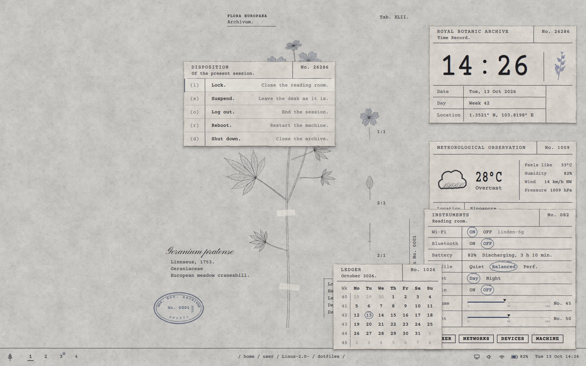

# Archive: a botanical-archive desktop for Arch + Hyprland

The desktop as a sheet in a botanical archive. Windows are typed index cards
lying on the sheet, the wallpaper is the pressed specimen, and the bar is the
printed footer of the page. Grey paper and graphite by day; cyanotype blue at
night.

Built for the **ASUS ROG Zephyrus G14 (2024)** on Arch Linux, with
**Hyprland 0.55+** (Lua config) and **Quickshell 0.3+**. Everything except the
machine file is portable.


<sub>Rendered from the shell's own QML. Window shadows and the real terminal
are left out of this offscreen preview.</sub>

## Start here

On an Arch Linux that already runs Hyprland, one command installs the whole
theme:

```sh
git clone https://github.com/midnightrainveil-sketch/Linux-2.0-.git ~/archive
~/archive/setup.sh
```

(or unpack the `archive-theme` tarball anywhere and run `./setup.sh` in it; it
moves itself to `~/archive`). It installs the packages, links the
configuration (your old files go to `~/.archive-backup/`), names the G14's
GPUs if it finds a G14, builds the title-bar and paper-edge plugin, and offers
a typed login screen. Then reboot.

To update later, run `archive-update` in a terminal: it downloads the latest
version and runs the same setup (then reboot).

**→ [GUIDE.md](GUIDE.md)** walks through the same steps by hand, from a fresh
Arch install, with a check after each one.

## What's inside

| | |
| --- | --- |
| **Plate** (wallpaper) | The *Geranium pratense* sheet, whole, with its typed labels, stamp and tape; at night the same sheet printed as a cyanotype. Plates without text also work: then the shell types the labels itself. |
| **The desk** | At login: the three record cards on the right and a live terminal on the left, as in the reference. Drag them anywhere, right-click a card to put it away, close the terminal; the card button in the bar (or `Super + D`) lays the desk out again. |
| **Record cards** | Time Record (clock, date, week, coordinates), Meteorological Observation (Open-Meteo, no key), Audio Archive (any MPRIS player). Every `No.` is real data. |
| **Footer bar** | Sprig (launcher), typed workspaces with a blue underline, `/ home / atlas /` breadcrumb, sketched status marks, date. |
| **Popups** | Card Catalogue (launcher), Ledger (calendar), Instrument card (Wi-Fi, Bluetooth, battery, power profile, day/night, grain, volume and light rulers), Disposition (power menu). |
| **Correspondence** | The notification daemon: cards with a RECEIVED stamp; critical ones stay, with a madder URGENT stamp. |
| **Reading Room** | The lock screen. Signature field; REJECTED or ADMITTED stamps. |
| **Windows** | Paper cards with torn edges (drawn by the archivebars plugin from repeating tiles, any size), soft shadows, typed title bars with three ink dots and a ruled line, damped motion. |
| **Night** | At sunset the whole sheet crossfades over 2 s to cyanotype, and GTK, Qt and foot follow. |
| **Extras** | Paper grain per window (terminals and system tools; a title-bar toggle), colour profiles (ICC), foley sound theme hooks, screenshot filing with a stamp, plate importer. |



## Repository layout

```
GUIDE.md                    the install guide (start here)
install.sh                  links dotfiles/ into $HOME, installs packages, services
packages/                   pacman package lists (desktop, G14 extras)
dotfiles/
  .config/hypr/             hyprland.lua + archive/*.lua, hypridle.conf
  .config/quickshell/       the shell: theme/, services/, components/, modules/, assets/
  .config/archive/          settings.json, GTK colour sheets
  .config/foot, fastfetch, zsh, gtk-3.0, gtk-4.0, qt6ct, fontconfig, systemd/user
  .local/bin/               archive-mode, archive-update, archive-icons, archive-ros, archive-grain, archive-brightness, archive-icc, archive-plate, archive-screenshot, ...
  .local/share/archive/     plates (starter: Geranium pratense)
  .local/share/fonts/       Courier Prime, Pinyon Script (SIL OFL)
  .local/share/sounds/      the archive sound theme (record your own)
art/                        source artwork (twig, icons, weather, wallpaper)
tools/                      importers for art/, generators for grain, paper, GTK/Qt colours
docs/                       G14 notes, customising, design map, troubleshooting
```

## Docs

- [GUIDE.md](GUIDE.md): installation, phase by phase
- [docs/zephyrus-g14.md](docs/zephyrus-g14.md): the laptop side: asusctl, supergfxctl, NVIDIA, battery
- [docs/customise.md](docs/customise.md): settings, colours, plates, keybinds
- [docs/design-map.md](docs/design-map.md): every rule of the design spec, and where it lives
- [docs/troubleshooting.md](docs/troubleshooting.md)
- [docs/assets-wanted.md](docs/assets-wanted.md): the artwork sources in `art/` and how to replace them

## Credits

- Typefaces: [Courier Prime](https://github.com/quoteunquoteapps/CourierPrime)
  and [Pinyon Script](https://fonts.google.com/specimen/Pinyon+Script), both
  under the SIL Open Font License (licences included next to the fonts);
  [IBM Plex](https://github.com/IBM/plex) from the Arch repos.
- [Hyprland](https://hypr.land), [hyprland-plugins](https://github.com/hyprwm/hyprland-plugins)
  (hyprbars), [Quickshell](https://quickshell.org), [Open-Meteo](https://open-meteo.com).
