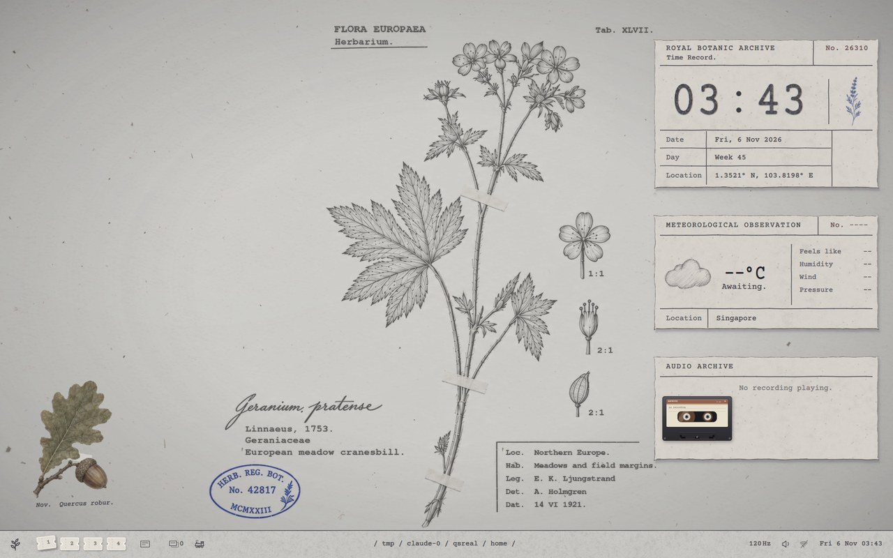
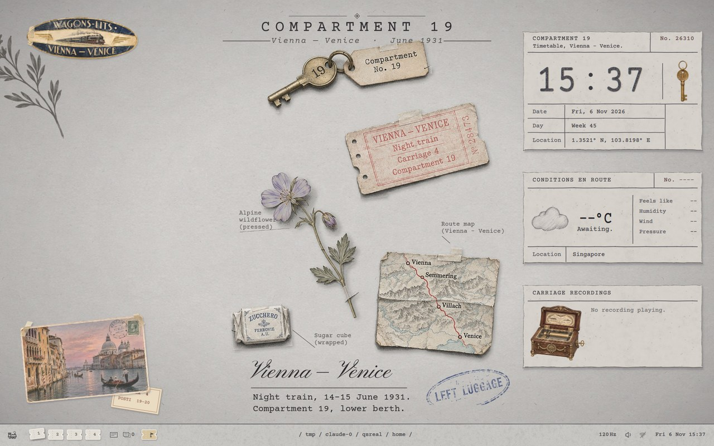
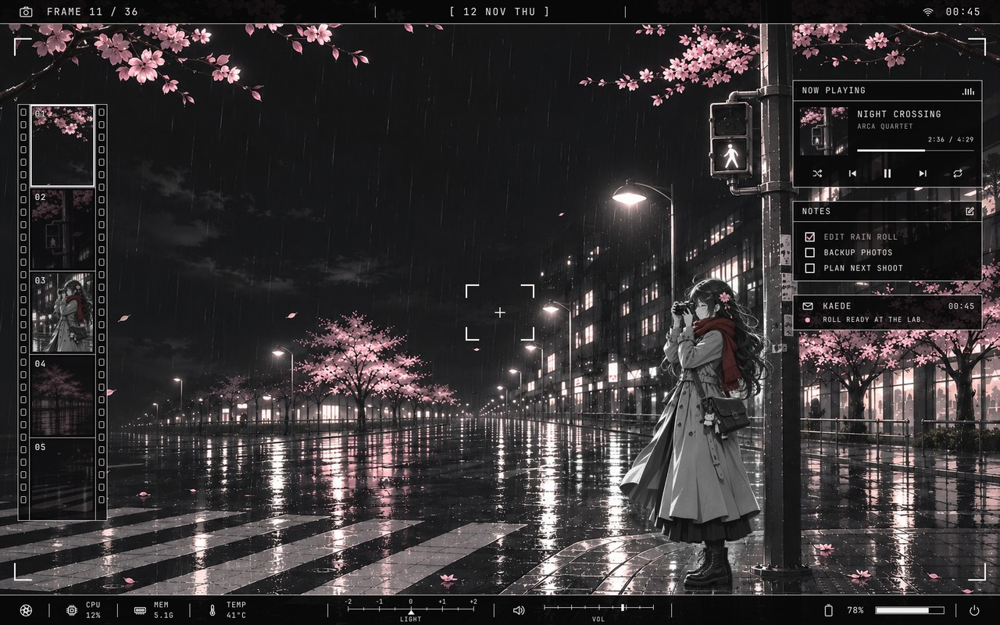
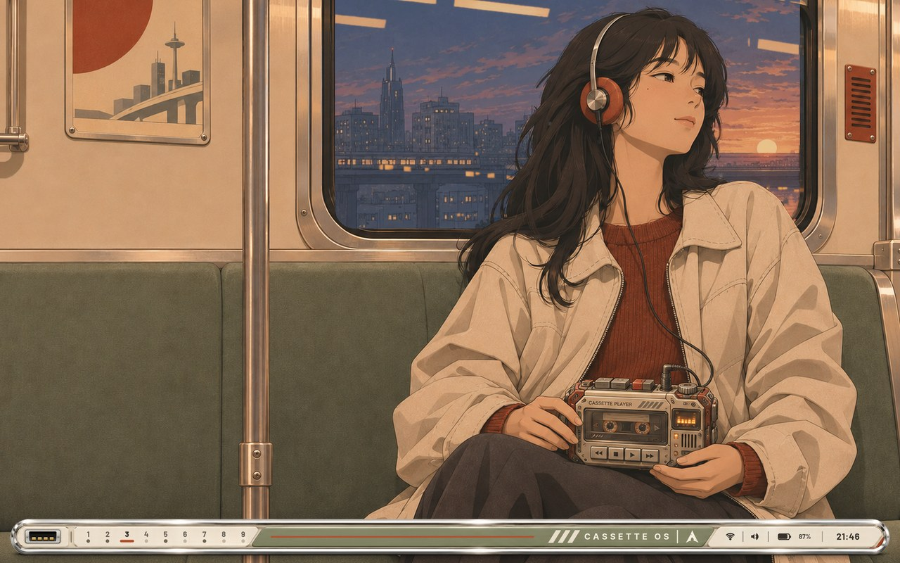

# Ultra: one machine, many desktops

A desktop for **Arch Linux + Hyprland**, in two halves:

- **The machine** (`core/`): everything that is not about looks. Screens,
  GPUs, power, Wi-Fi, the microphone, updates, restore points, the
  `ultra-*` commands. It is always there, whatever the desktop looks like.
- **The themes** (`themes/`): complete desktops, each in a box of its own:
  its shell, bar, widgets, wallpaper, fonts, sounds, lock screen and
  start-up page. Only the chosen one is ever in your home folder; the others
  are folders on disk, nothing more.

Change the theme from the Themes app in the launcher, or with
`ultra-theme set <id>`; it takes effect at the next log-in.

Built for the **ASUS ROG Zephyrus G14 (2024)**, with **Hyprland 0.55+**
(Lua config) and **Quickshell 0.3+**. Everything except the machine file
is portable.

## The themes

| | |
| --- | --- |
| [](themes/archive/) | **[Archive](themes/archive/)** · `archive`<br>A botanical herbarium on paper. Windows are typed index cards on the sheet, the wallpaper is the month's pressed specimen, the bar is the printed footer of the page. Grey paper and graphite by day, cyanotype blue at night. |
| [](themes/night-service/) | **[Compartment 19](themes/night-service/)** · `night-service`<br>A night in compartment 19 of the Vienna to Venice sleeper, 1930s. Keepsakes from the journey on the sheet, a postcard and a luggage label, the brass key on a timetable, a music box, a little train along the bar. |
| [](themes/viewfinder/) | **[Viewfinder](themes/viewfinder/)** · `viewfinder`<br>The desktop seen through a camera on a rainy night under the blossom: black and white with a little pink. Workspaces are frames of a film strip, windows are prints with a caption under each. |
| [](themes/retro-futurism/) | **[Retro Futurism](themes/retro-futurism/)** · `retro-futurism` · *in the works*<br>Cassette OS: a Japanese future grown out of the 1980s, gadgets in steel, cream and sage with e-ink screens. The wallpaper and the lock screen (its clock live) are done; the rest is still borrowed. |

<sub>Previews are rendered from each shell's own QML.</sub>

## Start here

On an Arch Linux that already runs Hyprland, one command installs the
machine and every theme:

```sh
git clone https://github.com/midnightrainveil-sketch/Linux-2.0-.git ~/ultra
~/ultra/setup.sh
```

(or unpack it anywhere and run `./setup.sh` in it; it copies itself to
`~/ultra`). It installs the packages, links the machine's files and the
chosen theme (your old files go to `~/.ultra-backup/`), names the G14's
GPUs if it finds a G14, builds each theme's icons and title-bar plugin, and
offers a typed login screen. Then reboot.

To update later: `ultra-update` (it downloads the latest version and runs
the same setup; then reboot).

**→ [GUIDE.md](GUIDE.md)** walks through the same steps by hand, from a fresh
Arch install, with a check after each one.

## The machine

Shared by every theme, and the same whichever is on. Hyprland's config
(`~/.config/hypr/hyprland.lua`) is a small selector: it sets up the
screens, GPUs and input from `ultra/machine.lua`, then hands over to the
chosen theme.

| Command | What it does |
| --- | --- |
| `ultra-theme` | List, choose (`set <id>`) or show (`current`) the theme |
| `ultra-update` | Fetch the latest version and install it |
| `ultra-rog` | The G14's graphics and power: NVIDIA driver, Hybrid mode, the dGPU off when unused |
| `ultra-profile` | Step through the power profiles (the fan key) |
| `ultra-refresh` | The panel's refresh rate: 60, 120, or Auto (follows the charger) |
| `ultra-brightness` | The screen's brightness |
| `ultra-icc` | A colour profile for a screen |
| `ultra-mic` | The laptop microphone, made clear |
| `ultra-lan` | Keep the office's machines reachable on a mesh Wi-Fi |
| `ultra-ros` | ROS Noetic and RViz in an Ubuntu container |
| `ultra-snapshot` | Restore points (Timeshift) before every system update |
| `ultra-memory` | Compressed swap in memory (zram) |
| `ultra-tune` | Small, reversible laptop tunings |
| `ultra-boot` | A quiet start-up and shut-down showing the theme's own page |
| `ultra-health` | What happened around a wake from sleep, timed |
| `ultra-browser`, `ultra-session` | Open the default browser; log out cleanly |

`setup.sh` also sets ssh keepalive and turns Wi-Fi power saving off for
good. Nothing depends on the kernel: `linux` and `linux-lts` are served alike.

## Repository layout

```
setup.sh                  installs everything (run again to update)
GUIDE.md                  the install guide, phase by phase
core/                     THE MACHINE, shared by every theme
  home/.config/hypr/        hyprland.lua (the selector), ultra/machine.lua
  home/.config/zsh, pipewire
  home/.local/bin/          the ultra-* commands above
  packages/                 the machine's packages (pacman.txt), the G14's (g14.txt)
themes/                   THE THEMES, one self-contained box each
  README.md                 how boxes are kept apart, and how to add one
  archive/                  the herbarium
  night-service/            Compartment 19
  viewfinder/               the camera
  retro-futurism/           Cassette OS (in the works; art/ holds its mock-ups)
    theme.json, preview*.jpg, packages.txt
    home/                   linked into $HOME while the theme is on
    system/plymouth/        its start-up and shut-down page
    tools/, art/, docs/     importers, source artwork, its own notes
docs/                     the machine's notes, the handover and test harness
```

## Docs

- [GUIDE.md](GUIDE.md): installation, phase by phase
- [themes/README.md](themes/README.md): how themes are kept apart, and how to add one
- [docs/zephyrus-g14.md](docs/zephyrus-g14.md): the laptop side: asusctl, GPU modes, NVIDIA, battery
- [docs/troubleshooting.md](docs/troubleshooting.md)
- [docs/HANDOVER.md](docs/HANDOVER.md): where a new session picks the project up
- Each theme's own page: [Archive](themes/archive/),
  [Compartment 19](themes/night-service/), [Viewfinder](themes/viewfinder/)

## Credits

- Typefaces: [Courier Prime](https://github.com/quoteunquoteapps/CourierPrime),
  [Pinyon Script](https://fonts.google.com/specimen/Pinyon+Script) and
  [JetBrains Mono](https://github.com/JetBrains/JetBrainsMono) and
  [Barlow](https://fonts.google.com/specimen/Barlow) and
  [VT323](https://fonts.google.com/specimen/VT323), under the SIL
  Open Font License (licences next to the fonts); [IBM Plex](https://github.com/IBM/plex)
  from the Arch repos.
- [Hyprland](https://hypr.land), [hyprland-plugins](https://github.com/hyprwm/hyprland-plugins)
  (hyprbars), [Quickshell](https://quickshell.org), [Open-Meteo](https://open-meteo.com).
