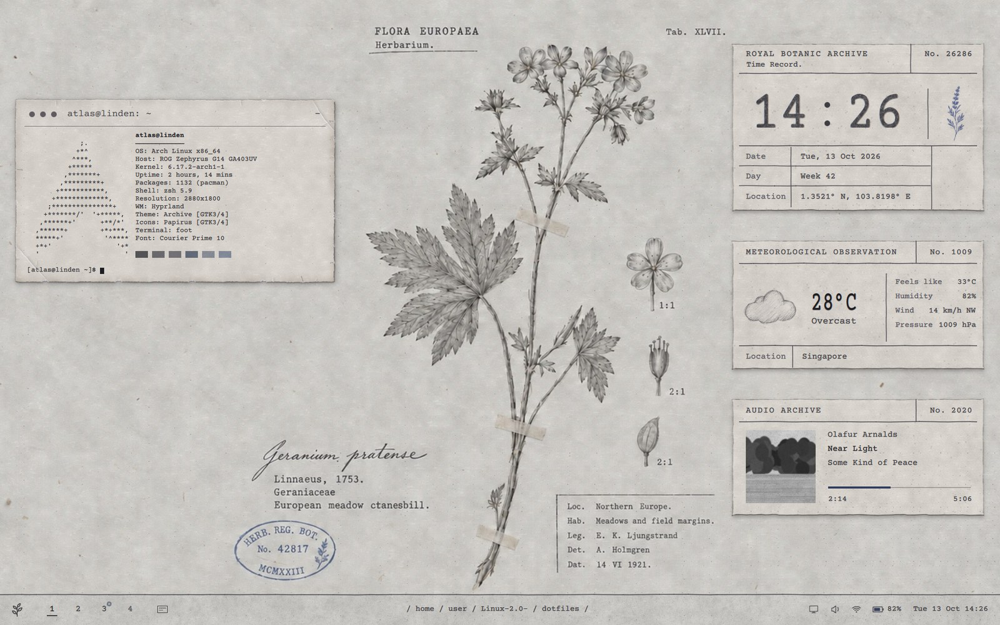
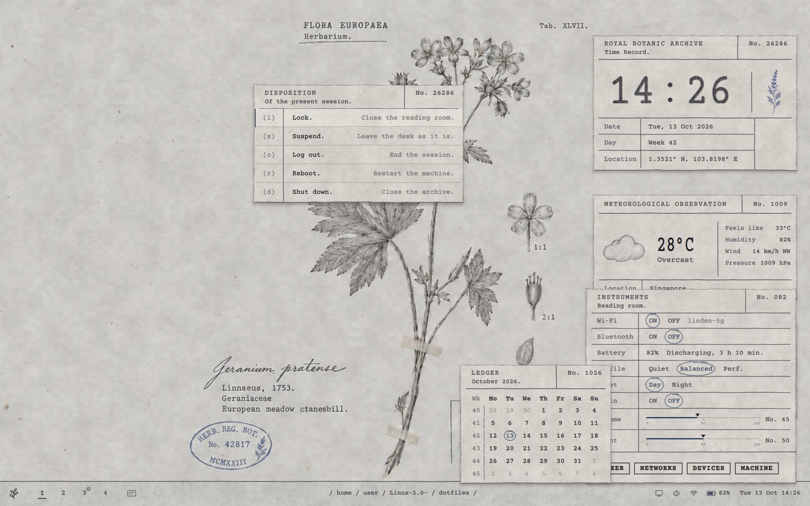
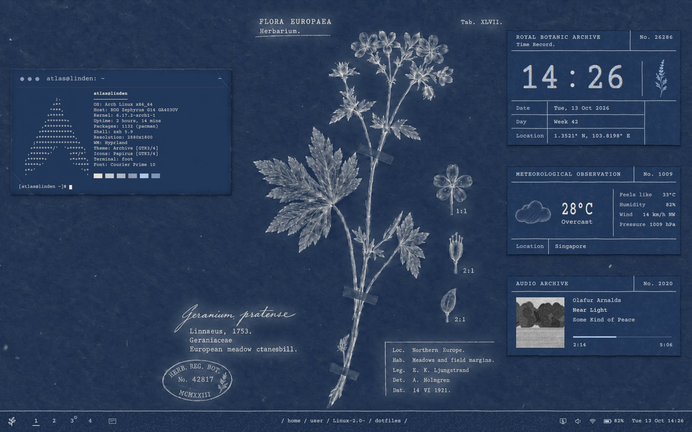

# Archive

`ultra-theme set archive`

The desktop as a sheet in a botanical archive. Windows are typed index cards
lying on the sheet, the wallpaper is the pressed specimen, and the bar is the
printed footer of the page. Grey paper and graphite by day; cyanotype blue at
night.

## What's inside

| | |
| --- | --- |
| **Plate** (wallpaper) | The *Geranium pratense* sheet, whole, with its typed labels, stamp and tape; at night the same sheet printed as a cyanotype. Plates without text also work: then the shell types the labels itself. |
| **The desk** | At login: the three record cards on the right and a live terminal on the left. Drag them anywhere, right-click a card to put it away, close the terminal; the card button in the bar (or `Super + D`) lays the desk out again. |
| **Record cards** | Time Record (clock, date, week, coordinates), Meteorological Observation (Open-Meteo, no key), Audio Archive (any MPRIS player). Every `No.` is real data. |
| **Footer bar** | Sprig (launcher), typed workspaces with a blue underline, `/ home / atlas /` breadcrumb, sketched status marks, date. |
| **Popups** | Card Catalogue (launcher), Ledger (calendar), Instrument card (Wi-Fi, Bluetooth, battery, power profile, day/night, grain, volume and light rulers), Disposition (power menu). |
| **Correspondence** | The notification daemon: cards with a RECEIVED stamp; critical ones stay, with a madder URGENT stamp. |
| **Reading Room** | The lock screen. Signature field; REJECTED or ADMITTED stamps. |
| **Windows** | Paper cards with torn edges (drawn by the archivebars plugin from repeating tiles, any size), soft shadows, typed title bars with three ticket-stub buttons and a ruled line, damped motion. |
| **Night** | At sunset the whole sheet crossfades over 2 s to cyanotype, and GTK, Qt and foot follow. |
| **Extras** | Paper grain per window (terminals and system tools; a title-bar toggle), colour profiles (ICC), foley sound theme hooks, screenshot filing with a stamp, plate importer. |

## Its docs

- [customise.md](docs/customise.md): settings, colours, plates, keybinds
- [design-map.md](docs/design-map.md): what each part of the design is
- [artwork.md](docs/artwork.md): the artwork's sources and how to replace them
