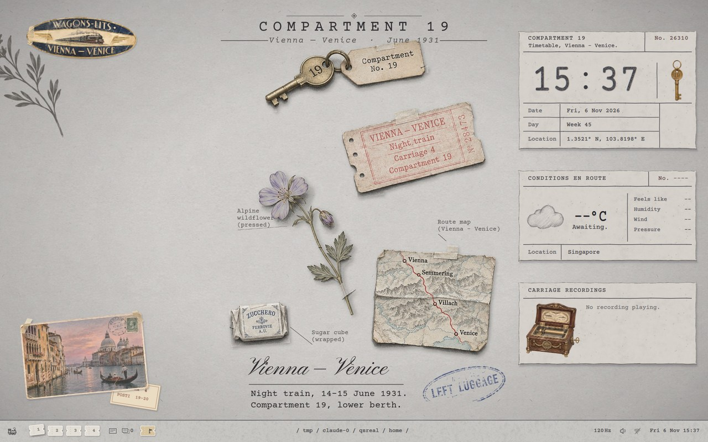
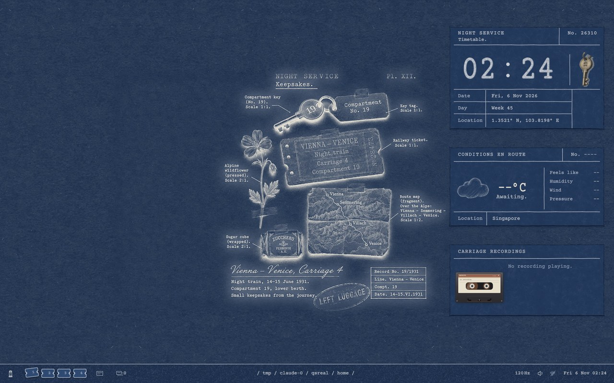

# Compartment 19

`ultra-theme set night-service`

A night in compartment 19 of the Vienna to Venice sleeper, in the 1930s:
keepsakes from the journey on the sheet, a postcard and a luggage label to
play with, the brass key on a timetable, a music box, a little train along
the bar.

It began as a copy of the [Archive](../archive/) and is now a box of its
own, with its own parts: ticket-stub workspaces, title-bar tickets (the
archivebars plugin), the train along the bar, inked file icons, the wax-seal
lock screen and a day / night crossfade.
