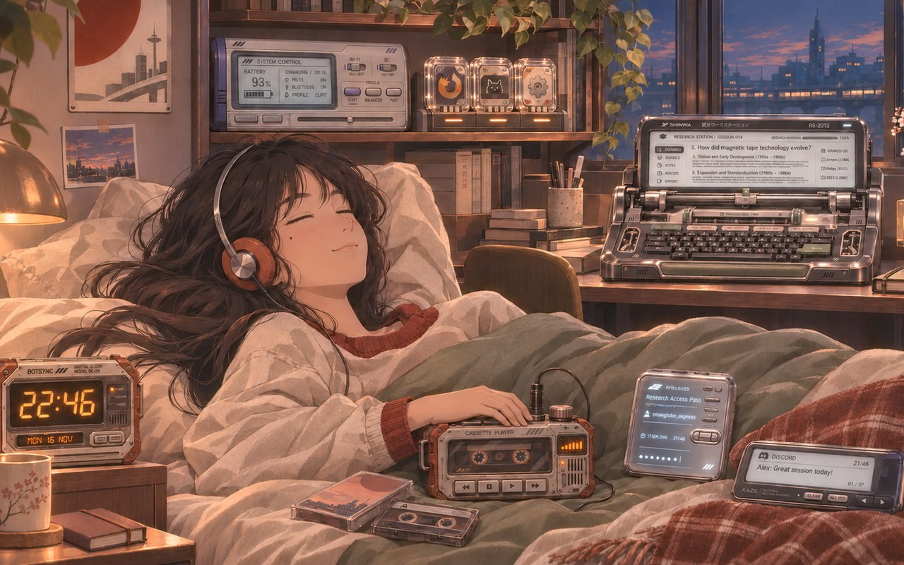

# Magnetic 88

`ultra-theme set retro-futurism`

Magnetic 88: a Japanese future grown out of the 1980s.
Gadgets in steel, cream and sage with e-ink screens.

## Done so far

- **Wallpaper**: the girl on the evening train, and the city going by
  outside her window: a long sunset over the river (`art/WindowView.png`,
  made to loop without a seam) slides past behind the glass, under the
  ceiling lights reflected in it. It comes round once every 90 seconds
  (`"windowSeconds"` in `~/.config/ultra/retro-futurism/settings.json`;
  0 holds it still) and stops while a window is fullscreen or covers the
  whole glass.
- **The ride**: the car sways very slightly all the time (slow waves that
  never fall into a beat; the city outside, being far off, moves less than
  the car), and every 18 to 45 seconds it runs over a rail joint: da-dum,
  da-dum, a short jolt from each axle of the front bogie and then the back
  one. `"sway"` and `"bumps"` (true / false) in settings.json.
- Her mole is a little clearer, on the wallpaper as on the lock screen.
- **Lock screen** (`modules/Lock.qml`): her room at night, the Suisei clock
  on the night stand live. Any key or click blurs the room and drops the
  Personal Access Pass down (`art/Login1.png`; the device itself is
  `art/Login0.png`, lifted off by `tools/make_pass.py`): your name, today,
  a dot for each key, what it is doing (ready, checking, denied,
  boarding). Let in, the pass shoots back up, the blur clears, the room
  fades into the desk (the city outside the window where the desk has it)
  and the taskbar comes up from below. The pass's buttons: ‖ sleep, POWER
  shut down (twice), USER clear, SESSION put the pass away, ◀◀ one key
  back, the roller and ▶▶ enter.

- **Taskbar** (`modules/Taskbar.qml`): the mock-up itself,
  `art/TaskbarEg.png`, along the foot of the screen, with what it shows
  drawn live where the mock-up has it (`tools/make_taskbar.py` cuts the bar
  out, erases its contents and splits it in three: the ends, and a slice
  of the band stretched to the screen's width). On the left the cartridge port (the
  slot the app cartridges go in; click it for the launcher, its lamp lit
  while the launcher is open); workspaces 1 to 6 (a dark dot where windows
  are, the red line under the one in view; click, or scroll to step); the
  sage band with its red line, MAGNETIC 88 and the Arch logo (click:
  the power menu); and Wi-Fi (click: nmtui), volume (scroll; click mutes),
  battery (one smooth bar and its percentage): click any of the three for
  the control deck, scroll for the volume; and the time.
  The cartridge port is painted into the picture by the tool (a slot in a
  chamfered steel bezel with two screws, the cartridges' four gold contacts
  on its floor); its contacts glow warm while the launcher is open. The
  figures (workspaces, battery, time) are in Barlow (SIL Open Font License,
  shipped with the theme).

- **Window rims**: every window has the taskbar's own chrome rim round it,
  at the taskbar rim's depth (17 px: its 22 px at the bar's size), drawn by
  Hyprland itself as it draws its own borders: the theme's **chromerim**
  plugin (`~/.local/share/ultra/retro-futurism/plugins/chromerim`, built for
  your Hyprland by `ultra-rim`, at setup and at login when Hyprland
  changes). So the rim moves, slides and resizes with its window in the same
  frame, at any size. The rim is the taskbar's own chrome: its pixels, cut
  from its picture by `tools/make_rim.py` (its ends' quarters for the corners,
  its straights for the edges), only scaled. The window in use has the bright rim, the
  others a shade darker. Until the plugin is built (and round X11 windows) the shell
  draws the same rim (`components/Frame.qml`). The gaps in
  `hypr/theme/look.lua` go with the frame values in `theme/Theme.qml`.
  `ultra-rim status` says whether it is built and loaded; `ultra-rim off`
  leaves it out. A window rule `chromerim:no_rim` leaves one window without.
- The taskbar runs the rims' full width (its middle band stretches) and
  hides below the screen while windows are open: take the pointer down to
  the bottom edge and it slides up over the windows, which stay where they
  are. Its tube then lies on the foot of their rims: its ends and foot on
  theirs, its round ends on their bottom corners (the windows are rounded
  21 px, so the rim round them bends as the taskbar's ends do).

- **Widgets** ([docs/widgets.md](docs/widgets.md)): the gadgets, called up
  over the blurred desk (Super + R the typewriter, Super + Space the
  launcher, Super + C the organizer ...) and worked with keys and clicks.
  Built so far: the **control deck** (click the taskbar's Wi-Fi, volume or
  battery): Wi-Fi and Bluetooth switches, power mode, refresh rate, lock
  time, volume and brightness faders, and a screen with the battery and the
  state of each; and the **clock** (click the taskbar's time): the time and
  date, an alarm and a timer that ring even with the clock put away. The
  **power** menu (the laptop's power button, or the Arch logo): the same
  silver device as the pass, its roller turned by the wheel; and the
  **launcher** (Super + Space): the Kairo cartridge launcher, your apps as
  cartridges on its rail, the wheel or the arrows to choose, typing to
  search, Enter to launch: the taskbar slides across on its arm, the
  slot's bracket lowers the cartridge into its port on the launcher's rods
  and the bar slides home; a cartridge stays there, the app of the window under the pointer.
  The rest are
  placeholders (their mock-up) until made.

Not built yet: the typewriter, the organizer, the cassette player and the
cassette vending machine (their keys show their mock-ups), and the pager:
notifications are plain cream cards at the top right until it is.

(The theme was begun as a copy of Viewfinder's box; everything of Viewfinder's
look is gone from it now.)

## How the lock screen's clock is made

`home/.local/share/ultra/retro-futurism/lock.jpg` is `art/Lockscreen.png`
with the clock's window and date strip emptied (also kept as
`art/Lockscreen-blank.png`). `modules/Lock.qml` fills the screen with it and
places the live parts in the picture's own pixels (1671 x 941):
`components/SevenSegment.qml` in the window (100,634 to 254,711) and
`components/DotMatrix.qml` in the date strip (114,723 to 218,740).

## How the window's view is made

- The wallpaper is `art/Wallpaper-Extended.jpg` (3840 x 2160): the old
  `art/Retro-Futuristic-Wallpaper.png` zoomed out, the car round it painted
  on (that picture is this one's 539,216 to 3300,1944, scaled 1.742).
- `tools/make_poster.py` prints the second poster again (the zooming out
  had copied the first into it): Mt. Fuji under a striped sun, a bullet
  train below, in the first poster's own inks, on its paper as it hangs
  there (its light, the frame's shadow and its grain kept).
- `tools/make_window_loop.py` turns `art/WindowView.png` into
  `window-view.jpg`: each column moved up or down so the viaduct runs level,
  then the right end joined to the left along the cut where the two look
  most alike (it follows a tower's edge), so the strip repeats without a
  seam; and 140 rows of evening sky on top, for the tall window.
- `tools/make_wallpaper_front.py` makes `wallpaper.jpg` (the whole picture)
  and `wallpaper-front.png`, only the window (1540,60 to 3010,950): its glass
  see-through, measured on the picture (the edges where the dark seal meets
  the glass, the corners' own radii), except where she is in front of it.
  Her edge is a closed-form matte (pymatting) between what is surely her,
  surely the view (its cool sky, its lit windows) and the band between,
  wide where her hair is; her loose strands kept for the matte to weigh;
  her colour there with the view behind taken back out; bits of the old
  view that are not her taken out; the reflected ceiling lights kept.
- `tools/make_cassette.py` cuts the cassette players' moving parts from
  `wallpaper.jpg` and `lock.jpg` (`cassette/`): each reel as a disc,
  centred where it looks most alike turned a quarter (so it spins without
  a wobble), and each level meter's window with its painted bars taken out.
  While music plays, `components/CassettePlay.qml` turns the reels and
  lights the meter's bars to the music (`services/Spectrum.qml`: six bands
  from `cava`, with a stand-in if cava is missing), on the desk and on the
  lock screen alike.
- `modules/Backdrop.qml` lays the whole picture, the view in the glass
  (1566,76 to 2982,922 of the picture) and the window over it.
