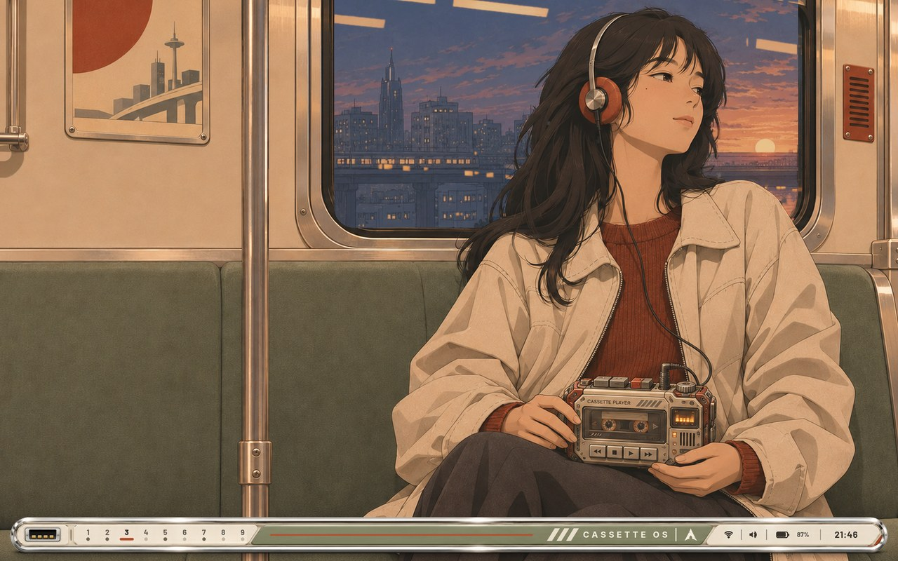

# Retro Futurism

`ultra-theme set retro-futurism`

*In the works.* Cassette OS: a Japanese future grown out of the 1980s.
Gadgets in steel, cream and sage with e-ink screens.

## Done so far

- **Wallpaper**: the girl on the evening train, and the city going by
  outside her window: a long sunset over the river (`art/WindowView.png`,
  made to loop without a seam) slides past behind the glass, under the
  ceiling lights reflected in it. It comes round once every 90 seconds
  (`"windowSeconds"` in `~/.config/ultra/retro-futurism/settings.json`;
  0 holds it still) and stops while a window is fullscreen or covers the
  whole glass.
- **The ride**: the car sways very slightly all the time (slow waves that
  never fall into a beat; the city outside, being far off, moves less than
  the car), and every 18 to 45 seconds it runs over a rail joint: da-dum,
  da-dum, a short jolt from each axle of the front bogie and then the back
  one. `"sway"` and `"bumps"` (true / false) in settings.json.
- Her mole is a little clearer, on the wallpaper as on the lock screen.
- **Lock screen** (`modules/Lock.qml`): her room at night, the Suisei clock
  on the night stand live. Any key or click blurs the room and drops the
  Personal Access Pass down (`art/Login1.png`; the device itself is
  `art/Login0.png`, lifted off by `tools/make_pass.py`): your name, today,
  a dot for each key, what it is doing (ready, checking, denied,
  boarding). Let in, the pass shoots back up, the blur clears, the room
  fades into the desk (the city outside the window where the desk has it)
  and the taskbar comes up from below. The pass's buttons: ‖ sleep, POWER
  shut down (twice), USER clear, SESSION put the pass away, ◀◀ one key
  back, the roller and ▶▶ enter.

- **Taskbar** (`modules/Taskbar.qml`): the mock-up itself,
  `art/TaskbarEg.png`, along the foot of the screen, with what it shows
  drawn live where the mock-up has it (`tools/make_taskbar.py` cuts the bar
  out, erases its contents and splits it in three: the ends, and a slice
  of the band stretched to the screen's width). On the left the cartridge port (the
  slot the app cartridges go in; click it for the launcher, its lamp lit
  while the launcher is open); workspaces 1 to 9 (a dark dot where windows
  are, the red line under the one in view; click, or scroll to step); the
  sage band with its red line, CASSETTE OS and the Arch logo (click:
  the power menu); and Wi-Fi (click: nmtui), volume (scroll; click mutes),
  battery (one smooth bar and its percentage): click any of the three for
  the control deck, scroll for the volume; and the time.
  The cartridge port is painted into the picture by the tool (a slot in a
  chamfered steel bezel with two screws, the cartridges' four gold contacts
  on its floor); its contacts glow warm while the launcher is open. The
  figures (workspaces, battery, time) are in Barlow (SIL Open Font License,
  shipped with the theme).

- **Window frames** (`modules/Backdrop.qml`, `tools/make_frame.py`): every
  window sits in the mock-up's sage-and-chrome frame (`art/WindowFrame.png`,
  its corners kept and its sides stretched, so it fits any size and follows
  the window as it opens, moves and resizes). Windows fill nearly the whole
  screen, 45 px in; the frame lies in that margin with a small shaded gap
  inside it. The window in use has the bright frame, the others are
  dimmed. Hyprland draws no border of its own (`hypr/theme/look.lua`; its
  gaps go with the frame values in `theme/Theme.qml`).
- The taskbar runs the frames' full width (its middle band stretches) and
  hides below the screen while windows are open: take the pointer down to
  the bottom edge and it slides up, and the windows lift with it, their
  frames ending just over it, its ends under theirs.

- **Widgets** ([docs/widgets.md](docs/widgets.md)): the gadgets, called up
  over the blurred desk (Super + R the typewriter, Super + Space the
  launcher, Super + C the organizer ...) and worked with keys and clicks.
  Built so far: the **control deck** (click the taskbar's Wi-Fi, volume or
  battery): Wi-Fi and Bluetooth switches, power mode, refresh rate, lock
  time, volume and brightness faders, and a screen with the battery and the
  state of each; and the **clock** (click the taskbar's time): the time and
  date, an alarm and a timer that ring even with the clock put away. The
  rest are placeholders (their mock-up) until made.

Everything else (panels, notifications) is still Viewfinder's,
copied into this box, until each part gets its own design from the mock-ups
in [`art/`](art/).

## How the lock screen's clock is made

`home/.local/share/ultra/retro-futurism/lock.jpg` is `art/Lockscreen.png`
with the clock's window and date strip emptied (also kept as
`art/Lockscreen-blank.png`). `modules/Lock.qml` fills the screen with it and
places the live parts in the picture's own pixels (1671 x 941):
`components/SevenSegment.qml` in the window (100,634 to 254,711) and
`components/DotMatrix.qml` in the date strip (114,723 to 218,740).

## How the window's view is made

- `tools/make_window_loop.py` turns `art/WindowView.png` into
  `window-view.jpg`: each column moved up or down so the viaduct runs level,
  then the right end joined to the left along the cut where the two look
  most alike (it follows a tower's edge), so the strip repeats without a seam.
- `tools/make_wallpaper_front.py` makes `wallpaper-front.png`: the
  wallpaper with the glass see-through, except where she is in front of it
  (her hair is warm, the city cool: the warm region joined to her face; along
  her outline a soft matte, with the old view's colour taken back out), and
  the reflected ceiling lights kept over the glass.
- `modules/Backdrop.qml` lays the view in the glass (592,0 to 1400,403 in
  the 1585 x 992 picture) and the front over it.
