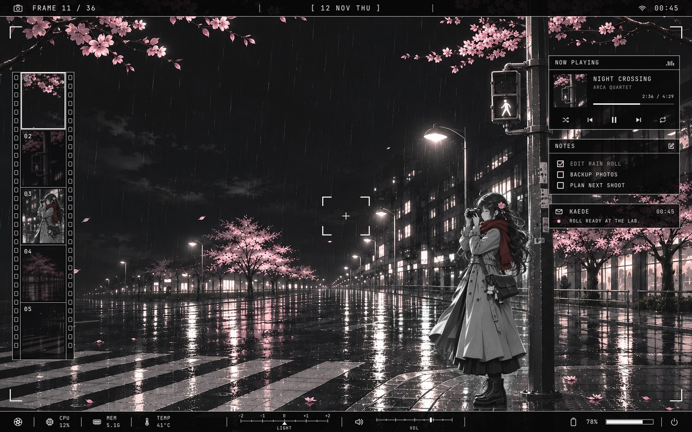

# Viewfinder

`ultra-theme set viewfinder`

The desktop seen through a camera on a rainy night under the blossom: black
and white with a little pink. Thin white lines, small capitals, full
contrast, one strong picture.

- **Two bars**, and a **film strip** of workspaces down the left.
- **Windows are prints**: a caption under each, focus marks round the one in
  use (drawn by the shell from Hyprland's window list, no plugin).
- **On the right**: now playing, notes and notifications.
- A small terminal on the picture, a launcher, power menu, themes, lock
  screen and start-up page.
- The camera in the corner takes the screenshot.

No day / night, no title bars, no sounds. Written from nothing, small (about
30 files of shell).
